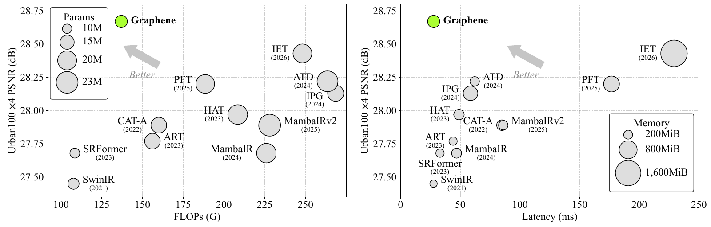
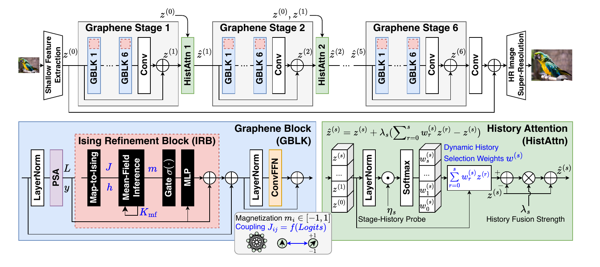

# Graphene: A Lightweight Transformer with Ising Mean-Field Refinement for Image Super-Resolution

Official PyTorch implementation of **Graphene**, with classical, lightweight, and real-world SR training, inference, efficiency profiling, and reference checkpoints for ×2, ×3, and ×4 super-resolution. The variants use the names `graphene-classical`, `graphene-lightweight`, and `graphene-realworld`, respectively.

By **Seungki Hong** and **Taekwang Jang**<br>
ETH AI Center, ETH Zurich

[](https://arxiv.org/abs/2611.11139)
[](https://github.com/skethz/Graphene)
[](https://github.com/skethz/Graphene/releases/tag/reference-checkpoints)
[](#results)

> **Abstract:** Graphene combines an Ising Refinement Block (IRB) for local feature refinement with History Attention (HistAttn) for stage-history feature refinement. IRB reuses attention outputs and pre-softmax logits to construct signed token couplings, applies finite mean-field updates, and gates a residual feature correction. HistAttn selects among the current and earlier representations at each token position. On Urban100 at ×4, Graphene and Graphene-light improve over IET and IET-light by **0.24 dB** and **0.38 dB**, respectively, with **34.3%/13.7% fewer parameters, 44.8%/44.4% fewer FLOPs, 78.4%/71.5% lower latency, and 83.9%/87.9% lower peak memory**. Real-world SR comparisons further illustrate detail and texture recovery.

<p align="center">
  
</p>

## 📑 Contents

1. [Installation](#installation)
2. [Pretrained Models](#pretrained-models)
3. [Inference](#inference)
4. [Training](#training)
5. [Results](#results)
6. [Efficiency Profiling](#efficiency-profiling)
7. [Model Overview](#model-overview)
8. [Citation](#citation)

## <a name="installation"></a> ⚙️ Installation

Python 3.12 and CUDA-enabled PyTorch 2.9.1 are the reference environment. BF16 training and compiled profiling require a compatible NVIDIA GPU. CPU inference is available with `--device cpu --precision fp32`.

```bash
git clone https://github.com/skethz/Graphene.git
cd Graphene
conda create -n graphene python=3.12 -y
conda activate graphene
pip install -r requirements.txt
```

Select the CUDA build of PyTorch appropriate for the system using the [official installation instructions](https://pytorch.org/get-started/locally/). GPU measurements in the manuscript use an NVIDIA GH200. The training recipe specifies 16 RTX 5090 GPUs with a **global batch size of 32**.

## <a name="pretrained-models"></a> 🧩 Pretrained Models

Original checkpoint files are provided as [release assets](https://github.com/skethz/Graphene/releases/tag/reference-checkpoints). The full models exceed GitHub's individual Git-file limit. Download the weights separately after cloning:

```bash
gh auth login
gh release download reference-checkpoints --repo skethz/Graphene \
  --pattern '*.pth' --dir checkpoints
python -m tools.check_checkpoints
```

The reference checkpoints are publicly available in the release linked above. The [checkpoint manifest](checkpoints/manifest.json) records byte sizes and SHA-256 hashes.

| Task | Scale | Configuration | Checkpoint |
| --- | --- | --- | --- |
| Classical SR | ×2 | [graphene-classical_x2.json](configs/graphene-classical_x2.json) | `graphene-classical_x2.pth` |
| Classical SR | ×3 | [graphene-classical_x3.json](configs/graphene-classical_x3.json) | `graphene-classical_x3.pth` |
| Classical SR | ×4 | [graphene-classical_x4.json](configs/graphene-classical_x4.json) | `graphene-classical_x4.pth` |
| Lightweight SR | ×2 | [graphene-lightweight_x2.json](configs/graphene-lightweight_x2.json) | `graphene-lightweight_x2.pth` |
| Lightweight SR | ×3 | [graphene-lightweight_x3.json](configs/graphene-lightweight_x3.json) | `graphene-lightweight_x3.pth` |
| Lightweight SR | ×4 | [graphene-lightweight_x4.json](configs/graphene-lightweight_x4.json) | `graphene-lightweight_x4.pth` |
| Real-world SR | ×4 | [graphene-realworld_x4.json](configs/graphene-realworld_x4.json) | `graphene-realworld_x4.pth` |

The inference loader checks every learned tensor strictly. Input-size-dependent attention masks are reconstructed from the selected architecture. Training and testing datasets are supplied separately.

## <a name="inference"></a> 🔧 Inference

Classical ×4 SR:

```bash
CUDA_VISIBLE_DEVICES=0 python -m tools.infer \
  --config configs/graphene-classical_x4.json --checkpoint checkpoints/graphene-classical_x4.pth \
  --input /path/to/LR --output outputs/graphene-classical_x4
```

For Graphene-lightweight, select the matching `graphene-lightweight_x{2,3,4}.json` configuration and checkpoint. To evaluate PSNR/SSIM, add `--hr /path/to/HR`. Standard equal-name pairs, DIV2K `0001x4.png`/`0001.png` pairs, and `*_LRBI_x4.png`/`*_HR_x4.png` pairs are supported.

Classical/lightweight quality evaluation uses **FP32**, EMA weights, one forward pass, and no self-ensemble. Bottom/right flip-concatenation padding completes attention windows; the output is cropped to the scaled original extent. Predictions are clamped and rounded to 8-bit PNGs. PSNR/SSIM use floating-point Y-channel values and shave a border equal to the scale. See [evaluation conventions](docs/reproduction.md).

Real-world ×4 SR uses a separate environment matching the released qualitative images (PyTorch 2.10.0, CUDA 13.0, cuDNN 9.15.1):

```bash
conda create -n graphene-realworld python=3.11 -y
conda activate graphene-realworld
pip install -r requirements-real.txt
```

```bash
CUDA_VISIBLE_DEVICES=0 python -m tools.infer \
  --config configs/graphene-realworld_x4.json --checkpoint checkpoints/graphene-realworld_x4.pth \
  --input /path/to/RealSRSet+5images --output outputs/graphene-realworld_x4
```

The real-world configuration uses BF16 eager inference, its nearest-neighbor/convolution reconstruction head, and reflection padding. RealSRSet+5images has no aligned HR references; its comparison is qualitative.

## <a name="training"></a> 🔥 Training

Prepare paired bicubic LR and HR images from **DIV2K + Flickr2K (DF2K)**. Image directories and encoded-image LMDBs with `meta_info.txt` are supported. Each LR image must support a **128×128 crop**; HR crops are therefore 256×256, 384×384, or 512×512 at ×2, ×3, or ×4. Generate bicubic LR images with the dataset's MATLAB-compatible degradation convention before training.

```bash
torchrun --standalone --nproc_per_node=16 -m tools.train \
  --config configs/graphene-classical_x4.json \
  --hr /path/to/DIV2K/HR /path/to/Flickr2K/HR \
  --lr /path/to/DIV2K/LR/X4 /path/to/Flickr2K/LR/X4 \
  --output runs/graphene-classical_x4
```

Use the corresponding configuration for another scale or Graphene-lightweight. All six configurations implement the main paper's base recipe:

| Setting | Value |
| --- | --- |
| Training data | DF2K with bicubic LR inputs |
| LR patch / global batch | 128×128 / 32 |
| Iterations / loss | 500,000 / L1 |
| Encoder linear matrices | Muon |
| Remaining parameters | Adam, β=(0.9, 0.999) |
| Initial learning rates | 2×10⁻⁴ for both optimizers |
| LR milestones | 250k, 400k, 450k, 475k; multiply by 0.5 |
| Augmentation | Random flips and right-angle rotations |
| Precision | BF16 autocast; FP32 parameters and optimizer states |
| Evaluation weights | EMA, decay 0.999 |

On fewer GPUs, `--micro-batch` enables gradient accumulation while preserving the global batch of 32. For example, on one GPU:

```bash
CUDA_VISIBLE_DEVICES=0 python -m tools.train \
  --config configs/graphene-lightweight_x2.json \
  --hr /path/to/DF2K/HR --lr /path/to/DF2K/LR/X2 \
  --micro-batch 1 --activation-checkpoint --output runs/graphene-lightweight_x2
```

Resume with the same configuration and `--resume runs/graphene-lightweight_x2/training.pth`. Training saves both optimizer states, current weights, EMA weights, and the iteration count. The architecture and optimizer allocation are described in the [training guide](docs/training.md).

### Real-world SR training

Real-world training follows the [SwinIR training setup in KAIR](https://github.com/cszn/KAIR/blob/fc1732f4a4514e42ce15e5b3a1e18c828af47a1e/docs/README_SwinIR.md#training), using Graphene-realworld as the generator. Prepare clean HR images from **DIV2K + Flickr2K + OST**; BSRGAN degradation creates LR/HR pairs online. This separate recipe uses 64×64 LR / 256×256 HR patches, global batch 32, Adam, and FP32 training.

Activate the `graphene-realworld` environment and run L1 pretraining:

```bash
torchrun --standalone --nproc_per_node=8 -m tools.train_real \
  --config configs/train_graphene-realworld_x4_psnr.json \
  --hr /path/to/DIV2K/HR /path/to/Flickr2K/HR /path/to/OST/HR \
  --output runs/graphene-realworld_psnr
```

Then initialize GAN fine-tuning with the resulting EMA generator:

```bash
torchrun --standalone --nproc_per_node=8 -m tools.train_real \
  --config configs/train_graphene-realworld_x4_gan.json \
  --initialize runs/graphene-realworld_psnr/ema_1000000.pth \
  --hr /path/to/DIV2K/HR /path/to/Flickr2K/HR /path/to/OST/HR \
  --output runs/graphene-realworld_gan
```

GAN fine-tuning uses L1 pixel loss, frozen VGG19 perceptual loss, and a U-Net discriminator with spectral normalization. `--micro-batch` preserves global batch 32 through accumulation on fewer GPUs. `--resume` restores the selected stage, including both optimizers and the discriminator for GAN training. See the [real-SR recipe](docs/training.md#real-world-sr) for schedules and data requirements.

## <a name="results"></a> 📊 Results

Manuscript PSNR/SSIM results:

| Model | Scale | Set5 | Set14 | BSD100 | Urban100 | Manga109 |
| --- | --- | --- | --- | --- | --- | --- |
| Graphene | ×2 | 38.81 / 0.9637 | 35.33 / 0.9300 | 32.92 / 0.9082 | 35.25 / 0.9512 | 40.85 / 0.9820 |
| Graphene | ×3 | 35.24 / 0.9337 | 31.38 / 0.8580 | 29.69 / 0.8195 | 31.06 / 0.8984 | 35.91 / 0.9569 |
| Graphene | ×4 | 33.27 / 0.9070 | 29.43 / 0.8001 | 28.12 / 0.7542 | 28.67 / 0.8483 | 32.89 / 0.9316 |
| Graphene-light | ×2 | 38.34 / 0.9617 | 34.59 / 0.9253 | 32.58 / 0.9042 | 33.91 / 0.9424 | 39.90 / 0.9796 |
| Graphene-light | ×3 | 34.87 / 0.9305 | 31.00 / 0.8511 | 29.49 / 0.8140 | 29.98 / 0.8809 | 35.01 / 0.9520 |
| Graphene-light | ×4 | 32.80 / 0.9007 | 29.19 / 0.7922 | 27.94 / 0.7468 | 27.79 / 0.8243 | 31.93 / 0.9225 |

## <a name="efficiency-profiling"></a> ⏱️ Efficiency Profiling

The main benchmark comparison uses **FP32 eager inference for every method**, RGB LR inputs of shape 1×3×64×64, and two FLOPs per MAC. The original baseline measurements are retained; Graphene and Graphene-light are measured in FP32 using the unchanged reference checkpoints.

| Model | Scale | Parameters | FLOPs | FP32 eager latency | FP32 peak allocated memory |
| --- | --- | --- | --- | --- | --- |
| Graphene | ×2 | 12.9M | 132.0G | 49.0 ms | 276.9 MiB |
| Graphene | ×3 | 13.0M | 133.5G | 44.7 ms | 276.9 MiB |
| Graphene | ×4 | 13.0M | 137.0G | 49.6 ms | 278.1 MiB |
| Graphene-light | ×2 | 672.1K | 6.8G | 21.1 ms | 69.3 MiB |
| Graphene-light | ×3 | 680.3K | 6.9G | 21.7 ms | 69.6 MiB |
| Graphene-light | ×4 | 691.6K | 7.0G | 20.7 ms | 69.9 MiB |

Relative reductions use the unrounded Graphene measurements. BF16 compiled results are reported separately in the paper's appendix; the ×4 reference points are 27.7 ms / 238.2 MiB for Graphene and 11.2 ms / 58.1 MiB for Graphene-light.

```bash
CUDA_VISIBLE_DEVICES=0 python -m tools.profile \
  --config configs/graphene-classical_x4.json --checkpoint checkpoints/graphene-classical_x4.pth \
  --counts-only --output outputs/graphene-classical_x4_counts.json

CUDA_VISIBLE_DEVICES=0 python -m tools.profile \
  --config configs/graphene-classical_x4.json --checkpoint checkpoints/graphene-classical_x4.pth \
  --precision fp32 --cpu-threads 72 --output outputs/graphene-classical_x4_fp32.json

CUDA_VISIBLE_DEVICES=0 python -m tools.profile \
  --config configs/graphene-classical_x4.json --checkpoint checkpoints/graphene-classical_x4.pth \
  --precision bf16 --compile --cpu-threads 72 --output outputs/graphene-classical_x4_bf16.json
```

Each runtime command launches three fresh processes, each with 50 warm-up and 200 timed passes, and reports the median of their mean latencies and peak allocations. TF32 is disabled. FP32 eager is the default; the BF16 command uses autocast, FP32 input/output layers, and static-shape `torch.compile`. The reference hardware is a GH200 with Python 3.12.3, PyTorch 2.9.1, CUDA 13.0, and cuDNN 9.23; latency and memory depend on the GPU, software environment, and concurrent workload. See [profiling details](docs/reproduction.md#efficiency).

## <a name="model-overview"></a> Model Overview

<p align="center">
  
</p>

| Component | Graphene | Graphene-light |
| --- | --- | --- |
| Stages × blocks | 6×6 | 4×6 |
| Feature channels | 180 | 60 |
| Attention window / heads | 32 / 6 | 16 / 6 |
| PSA reduction | 2 | 2 |
| Mean-field updates | 3 | 3 |
| IRB placement | Every block | Last block of each stage |
| ConvFFN expansion / depthwise kernel | 2 / 5×5 | 1 / 5×5 |
| Reconstruction | PixelShuffle | Direct PixelShuffle |

Both variants use signed, symmetric IRB couplings and stage-history attention. The implementation is in [`models/graphene.py`](models/graphene.py).

## <a name="citation"></a> Citation

```bibtex
@unpublished{hong2026graphene,
  title={Graphene: A Lightweight Transformer with Ising Mean-Field Refinement for Image Super-Resolution},
  author={Hong, Seungki and Jang, Taekwang},
  year={2026},
  note={Manuscript}
}
```
